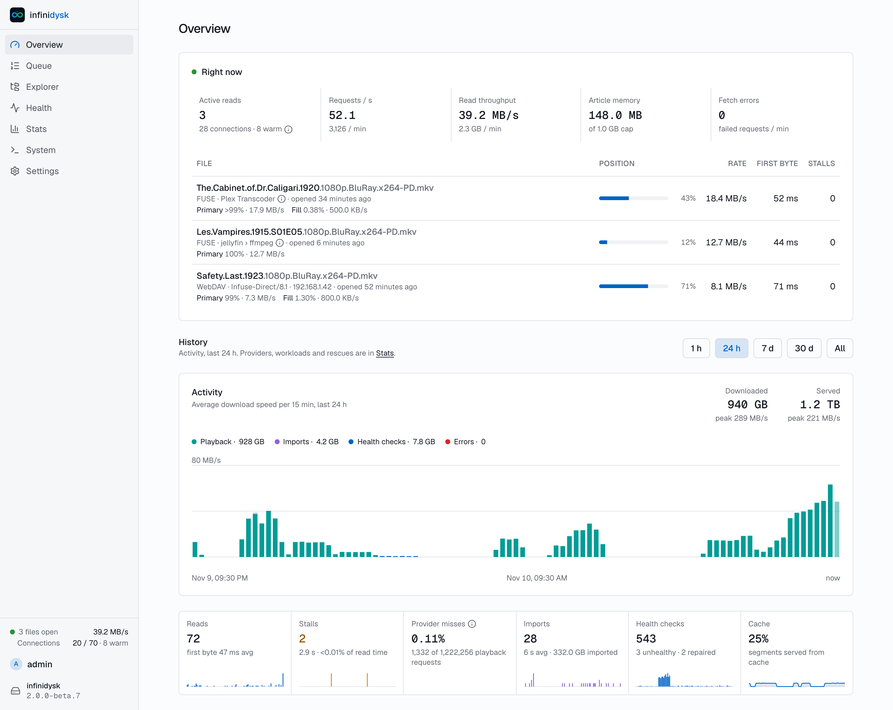

<p align="center">
  
</p>

<h1 align="center">InfiniDysk</h1>

<p align="center"><strong>Your media library, streamed from Usenet.</strong></p>

<p align="center">
  <a href="https://github.com/infinidysk/infinidysk/releases"></a>
  <a href="https://github.com/infinidysk/infinidysk/pkgs/container/infinidysk-next"></a>
  <a href="https://github.com/infinidysk/infinidysk/actions/workflows/ci.yml"></a>
  <a href="LICENSE"></a>
</p>

InfiniDysk is a Usenet-backed virtual filesystem. Sonarr, Radarr and other Arr apps add it as a SABnzbd download client. It never downloads the release: your media server reads the files over a native FUSE mount or WebDAV, and InfiniDysk streams them from your Usenet providers on demand.

This is InfiniDysk **2.0**, rewritten in Rust and now in **beta**. Docs: [infinidysk.com](https://www.infinidysk.com/). Chat: [Discord](https://discord.gg/DAya7W6QMa). Bugs and ideas: [issues](https://github.com/infinidysk/infinidysk/issues).

> [!WARNING]
> **Moving from 1.x to 2.x is a breaking change.** It needs manual steps: copy your config, run the import, and replace the rclone sidecar with the built-in mount. Changing the image name alone is not an upgrade. Some 1.x features are not in 2.x yet.
>
> [Pick a version](https://www.infinidysk.com/) first. To move, follow [Upgrade from 1.x](https://www.infinidysk.com/v2/upgrade/), and check [what is not in 2.x yet](https://www.infinidysk.com/v2/whats-new/#feature-comparison).

<picture>
  <source media="(prefers-color-scheme: dark)" srcset=".github/assets/overview-dark.png" />
  
</picture>

## Looking for 1.x?

1.x (the C# version) lives on the [`v1`](https://github.com/infinidysk/infinidysk/tree/v1) branch and keeps the `ghcr.io/infinidysk/infinidysk` image. It gets bug fixes only. Its docs are at [infinidysk.com/v1](https://www.infinidysk.com/v1/).

If your fork tracks 1.x, move it to `v1`:

```sh
git fetch upstream
git push origin upstream/v1:refs/heads/v1
```

Then set your fork's default branch to `v1` and sync that branch from now on. A fork with its own commits merges `upstream/v1` instead of `upstream/main`; it is the same history, so there are no new conflicts.

## Quick start

A new install. Coming from 1.x? Follow [Upgrade from 1.x](https://www.infinidysk.com/v2/upgrade/) instead, so your library and history carry over.

```yaml
services:
  infinidysk:
    image: ghcr.io/infinidysk/infinidysk-next:edge
    container_name: infinidysk
    restart: unless-stopped
    environment:
      PUID: 1000
      PGID: 1000
      TZ: Etc/UTC # your time zone, e.g. Europe/Oslo; the maintenance window follows it
    ports:
      - "3000:3000"
    volumes:
      - ./config:/config
      - /mnt:/mnt:rshared
      - /sys/devices/virtual/bdi:/sys/devices/virtual/bdi:rw
    devices:
      - /dev/fuse:/dev/fuse
    cap_add:
      - SYS_ADMIN
    security_opt:
      - apparmor:unconfined
```

Open `http://<host>:3000`, create the admin account, then add your providers. Do this before exposing the port to an untrusted network: until an admin exists, anyone who reaches the page can create one.

The UI, the SABnzbd API and WebDAV share port 3000. The library is mounted at `/mnt/infinidysk`. The image is `ghcr.io/infinidysk/infinidysk-next` for Linux x64 and arm64; `edge` is the newest 2.x release, every release also has its own `v2.x.y` tag, and there is no `latest` tag until 2.0 ships.

Next steps in the docs: [Run with Docker](https://www.infinidysk.com/v2/install/docker/), [Providers](https://www.infinidysk.com/v2/install/providers/), [Connect your Arr apps](https://www.infinidysk.com/v2/install/connect-arr/), [Settings](https://www.infinidysk.com/v2/reference/settings/).

PAR2 repair is an experiment: enable it in **Settings → Experiments**, then restart. **Settings → PAR2 repair** contains worker limits, storage use, live article progress and an existing-library backlog. Health shows the same backlog. Choose **Check existing library** to check every stored article for availability, or **Check and repair existing library** to queue PAR2 reconstruction when damage is found. Both queue small, resumable batches. Repair mode skips files without an original NZB; files from the same source set share one repair job. Stop adding files to end enumeration, then cancel individual pending jobs from the backlog if needed. Explorer file details offer **Check availability** and **Repair with PAR2**, separately from **Repair via Arr**.

Availability checks use small NNTP STAT requests plus first, middle and last article body spot checks. They need no PAR2 proof and do not download a whole file to hash it. This replaces the old full-provider verification action, including already queued verification jobs. An available result does not prove every byte is intact. Jobs in one scan share bounded article observations; a later manual check is fresh. Manual requests get priority, with every fourth turn reserved for waiting scan work. Availability and repair have separate workers, so reconstruction does not block cheap checks. Each worker can use its per-attempt memory allowance. Availability leaves provider connections free and yields when playback starts, then resumes without consuming a retry. Playback keeps priority over repair.

When enabled, confirmed health damage tries local repair before Arr replacement. Damaged imports wait for repair, then retry through verified saved articles. Unsupported compression and missing passwords still fail directly. Reconstruction still reads and verifies source data before publishing repairs. One repair runs at a time. Defaults are 64 concurrent availability requests while idle, 256 MB working memory per attempt (including metadata), 100 GB decoded source reads per attempt, one hour per attempt, three attempts and 10 GB saved repair capacity. Change these in **Settings → PAR2 repair**, then save; the next attempt uses the new limits. Environment overrides use `INFINIDYSK__REPAIR__CHECK_CONCURRENCY`, `MEMORY_MB`, `TRANSFER_GB`, `TIMEOUT_MINUTES`, `ATTEMPTS` and `STORAGE_GB` under the same prefix. Playback pauses availability checks. Body spot checks have a separate memory bound. Transport overhead and provider retries can add traffic. Referenced articles are never evicted to make room. Lowering capacity preserves existing repairs and blocks new writes when full; backups need additional disk space. Throughput release checks remain pending.

Saved repair articles live in `repairs/` inside your config folder (`/config/repairs` by default) for SQLite and PostgreSQL. Built-in backup and restore supports SQLite only. Those backups include verified repair bytes and pending C# repair candidates. For PostgreSQL, stop infinidysk, take a database dump with `pg_dump` and copy that repair directory as a matched pair. Restore both before restarting infinidysk. A dump alone cannot recover the repair bytes. Older database-only backups stay readable, and missing repairs trigger health rechecks. Cleanup waits while a restore undo or the SQLite copy from a PostgreSQL switch remains available. Back up config before upgrading.

To move an install, stop infinidysk and copy the whole config directory, including `repairs/`, before starting it at the new location.

Repairs for articles omitted from an NZB require a saved PAR2 recovery-set identity and trusted byte ranges. Older metadata stays readable; repair recovers missing proofs lazily from the original NZB when possible. Availability checks need stored article metadata; reconstruction needs the original NZB. C# repair files are preserved as candidates and become normal saved repairs only after full PAR2 verification. The importer retires its old reader after a complete rewrite pass and seven days without use; original C# files are retained.

Health and import checks use saved repairs when their source identity is known. A repair counts as available only after its bytes pass verification.

## Reporting problems

See [Reporting a bug](https://www.infinidysk.com/v2/help/reporting/): the image tag, a support pack from the System page, and for playback problems a read trace. Never post provider passwords or API keys. Release names are not needed; describe the file instead (for example "stored RAR5 episode").

## Development

1.x bug fixes go to the `v1` branch; everything else targets `main`. Read [AGENTS.md](AGENTS.md) for the project rules and [DESIGN.md](DESIGN.md) before changing the UI.

Requires [rustup](https://rustup.rs); the toolchain is pinned in `rust-toolchain.toml`.

```sh
cargo fmt --all --check
cargo clippy --workspace --all-targets --locked -- -D warnings
cargo test --workspace --locked
```

On Linux, also run `cargo test -p fuse3 --locked` for notification tests.
With `/dev/fuse` and mount permission, run `cargo test -p infinidysk --test repair_mount -- --ignored` to check repair publication through the kernel.

With `par2` installed, run `cargo run --release --locked -p infinidysk-bench -- --scenario par2-` to measure playback with idle, active, cancelled, and failed repairs on loopback NNTP. The benchmark uses `par2` to generate the fixture before timing.

`vendor/fuse3` contains fuse3 0.10.0 with checked inode invalidation. Keep this patch until upstream reports notification write errors. Its original license is retained.

## License

MIT
