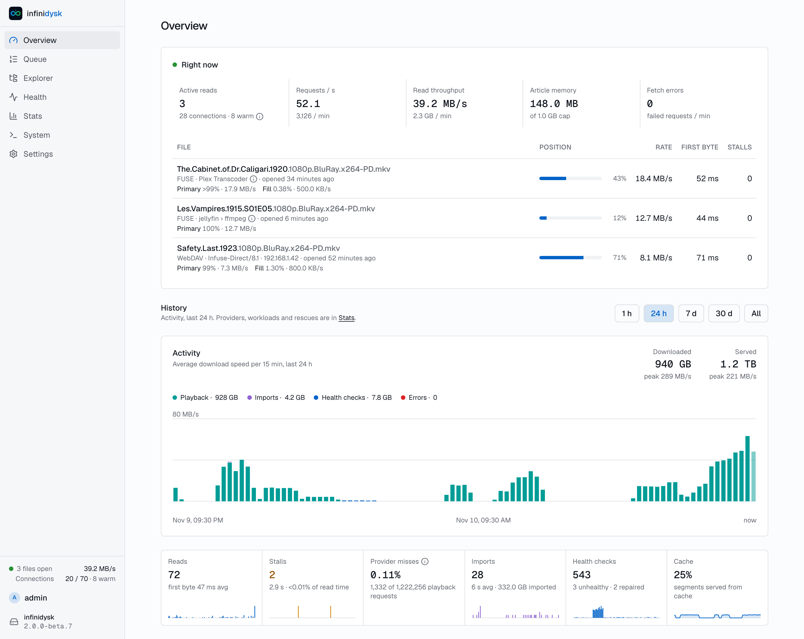

<p align="center">
  
</p>

<h1 align="center">infinidysk</h1>

<p align="center"><strong>Your media library, streamed from Usenet.</strong></p>

<p align="center">
  <a href="https://github.com/infinidysk/infinidysk/releases"></a>
  <a href="https://github.com/infinidysk/infinidysk/pkgs/container/infinidysk-next"></a>
  <a href="https://github.com/infinidysk/infinidysk/actions/workflows/ci.yml"></a>
  <a href="LICENSE"></a>
  <a href="https://discord.gg/DAya7W6QMa"></a>
</p>

<p align="center">
  <a href="https://www.infinidysk.com/">Docs</a> ·
  <a href="#quick-start">Quick start</a> ·
  <a href="https://www.infinidysk.com/v2/upgrade/">Upgrade from 1.x</a> ·
  <a href="https://discord.gg/DAya7W6QMa">Discord</a> ·
  <a href="https://github.com/infinidysk/infinidysk/issues">Issues</a>
</p>

infinidysk is a Usenet-backed virtual filesystem. Sonarr, Radarr and other Arr apps add it as a SABnzbd download client. It never downloads the release: your media server reads the files over a native FUSE mount or WebDAV, and infinidysk streams them from your Usenet providers on demand.

This is infinidysk **2.0**, rewritten in Rust and now in **beta**. On 1.x? See [Looking for 1.x?](#looking-for-1x)

> [!WARNING]
> **Moving from 1.x to 2.x is a breaking change.** Changing the image name alone is not an upgrade. Follow [Upgrade from 1.x](https://www.infinidysk.com/v2/upgrade/), and check [what is not in 2.x yet](https://www.infinidysk.com/v2/whats-new/#feature-comparison).

<picture>
  <source media="(prefers-color-scheme: dark)" srcset=".github/assets/overview-dark.png" />
  
</picture>

## Why infinidysk

- **No download.** The library streams straight from your Usenet providers, so it takes no disk space.
- **One container.** A single Rust binary with a built-in FUSE mount. There is no rclone sidecar.
- **Drop-in SABnzbd replacement.** Arr apps add it as a SABnzbd download client. No plugin is needed.
- **Files stay playable.** Health checks and PAR2 repair find and fix damaged files over time.
- **Playback first.** Throughput and prefetch have priority over memory usage.
- **Problems you can fix from the UI.** A failure shows one clear reason and a next step, and a read trace shows where playback stalled.

## Quick start

A new install. Coming from 1.x? Follow [Upgrade from 1.x](https://www.infinidysk.com/v2/upgrade/) instead, so your library and history carry over.

```yaml
services:
  infinidysk:
    image: ghcr.io/infinidysk/infinidysk-next:edge
    container_name: infinidysk
    restart: unless-stopped
    environment:
      PUID: 1000
      PGID: 1000
      TZ: Etc/UTC # your time zone, e.g. Europe/Oslo; the maintenance window follows it
    ports:
      - "3000:3000"
    volumes:
      - ./config:/config
      - /mnt:/mnt:rshared
      - /sys/devices/virtual/bdi:/sys/devices/virtual/bdi:rw
    devices:
      - /dev/fuse:/dev/fuse
    cap_add:
      - SYS_ADMIN
    security_opt:
      - apparmor:unconfined
```

Open `http://<host>:3000`, create the admin account, then add your providers. Do this before exposing the port to an untrusted network: until an admin exists, anyone who reaches the page can create one.

| | |
|---|---|
| **Port** | `3000`, shared by the UI, the SABnzbd API and WebDAV |
| **Mount** | The library is mounted at `/mnt/infinidysk` |
| **Image** | `ghcr.io/infinidysk/infinidysk-next`, for Linux x64 and arm64 |
| **Tags** | `edge` is the newest 2.x release. Every release also has its own `v2.x.y` tag. `nightly` is built from `main` every day; it is unreleased and shows no update notice. There is no `latest` tag until 2.0 ships. |

Next steps in the docs:

1. [Run with Docker](https://www.infinidysk.com/v2/install/docker/)
2. [Providers](https://www.infinidysk.com/v2/install/providers/)
3. [Connect your Arr apps](https://www.infinidysk.com/v2/install/connect-arr/)
4. [Settings](https://www.infinidysk.com/v2/reference/settings/)

## Status

2.0 is in beta. It is a from-scratch rewrite, so it does not have every 1.x feature yet.

**In 2.x now**

- Streaming over the built-in FUSE mount and WebDAV, with one memory and disk segment cache shared by both
- SABnzbd API for Sonarr, Radarr, Lidarr, Whisparr, Sportarr and Chaptarr
- Symlink or STRM import: symlinks for Plex and other apps on the mount host, STRM files for Emby, Jellyfin and Kodi without the mount
- NZBs with plain files, multipart files and stored RAR4, RAR5 and 7z members, including encrypted members when the NZB name or metadata carries the password
- Providers picked from a built-in catalog with backbones, priority levels, a download speed limit and per-provider quotas
- Health checks with media analysis, replacement through the Arr, and PAR2 repair as an experiment
- Arr queue management, webhooks and a daily library reconciliation
- SQLite and PostgreSQL, with a move from SQLite to PostgreSQL in the UI
- Accounts, single sign-on (OIDC) and optional sign-in bypass for local networks
- Backup and restore for SQLite, scheduled maintenance jobs and Prometheus metrics
- Read traces and support packs for playback problems
- A one-time import of your 1.x config, library and history

**Not in 2.x yet**

Addon routes are not in 2.x yet. Search, indexers, Prowlarr, Watchtower, Preflight and Warden are not planned. The [feature comparison](https://www.infinidysk.com/v2/whats-new/#feature-comparison) has the full list.

Compressed archives cannot be streamed. infinidysk detects them and fails the import with a clear reason.

### PAR2 repair

PAR2 repair is an experiment: enable it in **Settings → Experiments**, then restart. It has no other settings. Replacement through the Arr comes first. PAR2 repair is the fallback when no replacement is found, and files that health checks find degraded are repaired before they fail. Health lists pending jobs and the latest 20 results; cancel pending jobs there. Explorer file details offer **Check availability** and **Repair with PAR2**, separately from **Repair via Arr**. The scheduled health checks cover the existing library, so there is no library-wide scan.

Availability checks use small NNTP STAT requests plus first, middle and last article body spot checks. They need no PAR2 proof and do not download a whole file to hash it. An available result does not prove every byte is intact. Availability and repair have separate workers, so reconstruction does not block cheap checks. Availability leaves provider connections free and yields when playback starts, then resumes without consuming an attempt. Playback keeps priority over repair.

Limits are fixed. One repair runs at a time, with 256 MB working memory, 100 GB decoded source reads and one hour per attempt, and release sets up to 16 GB. A failed attempt retries after six hours, up to three attempts. A file found damaged beyond repair is not retried. Unsupported compression and missing passwords fail directly. Every reconstructed source passes full checksum verification before infinidysk publishes it, and all sets of one job publish together.

Saved repair articles live in `repairs/` inside your config folder (`/config/repairs` by default), up to 4 GB. When a new repair needs room, the least recently read repairs are removed and their files go back to health checks. Built-in backup and restore supports SQLite only; those backups include verified repair bytes and pending C# repair candidates. For PostgreSQL, stop infinidysk, take a database dump with `pg_dump` and copy that repair directory as a matched pair. Restore both before restarting infinidysk. A dump alone cannot recover the repair bytes; missing repairs trigger health rechecks. To move an install, stop infinidysk and copy the whole config directory, including `repairs/`. Back up config before upgrading.

Repairs for articles omitted from an NZB require a saved PAR2 recovery-set identity and trusted byte ranges. Repair recovers missing proofs from the original NZB when possible. C# repair files are preserved as candidates and become normal saved repairs only after full PAR2 verification. The importer retires its old reader after a complete rewrite pass and seven days without use; original C# files are retained.

When staging saved 1.x repair data, unusable candidates are reported and kept in the original directory. Valid candidates still migrate. Previously staged copies are checked and kept if their originals become unusable. Retries replace corrupt saved copies from usable originals. Saved bytes become repairs only after complete PAR2 verification.

## Reporting problems

See [Reporting a bug](https://www.infinidysk.com/v2/help/reporting/): the image tag, a support pack from the System page, and for playback problems a read trace. Never post provider passwords or API keys. Release names are not needed; describe the file instead (for example "stored RAR5 episode").

## Development

1.x bug fixes go to the `v1` branch; everything else targets `main`. Read [AGENTS.md](AGENTS.md) for the project rules and [DESIGN.md](DESIGN.md) before changing the UI.

Requires [rustup](https://rustup.rs); the toolchain is pinned in `rust-toolchain.toml`.

```sh
cargo fmt --all --check
cargo clippy --workspace --all-targets --locked -- -D warnings
cargo test --workspace --locked
```

With `/dev/fuse` and mount permission, run `cargo test -p infinidysk --test repair_mount -- --ignored` to check repair publication through the kernel.

With `par2` installed, run `cargo run --release --locked -p infinidysk-bench -- --scenario par2-` to measure playback with idle, active, cancelled, and failed repairs on loopback NNTP. The benchmark uses `par2` to generate the fixture before timing.

The workspace is a set of crates under [`crates/`](crates/). The product binary is [`crates/infinidysk`](crates/infinidysk); it embeds the web UI from `ui/dist`. The other crates are libraries (NNTP, yEnc, streaming, archives, PAR2, queue, health, Arr client, VFS, FUSE, WebDAV, database, 1.x importer), and dependencies point downward only.

To work on the UI, run the backend and the Vite dev server side by side. Vite proxies API calls to `http://127.0.0.1:3000`; set `BACKEND_URL` to point it elsewhere.

```sh
INFINIDYSK_CONFIG_DIR="$PWD/scrap/config" cargo run -p infinidysk
cd ui && npm ci && npm run dev
```

## Looking for 1.x?

1.x (the C# version) lives on the [`v1`](https://github.com/infinidysk/infinidysk/tree/v1) branch and keeps the `ghcr.io/infinidysk/infinidysk` image. It gets bug fixes only. Its docs are at [infinidysk.com/v1](https://www.infinidysk.com/v1/).

<details>
<summary>My fork tracks 1.x. How do I move it to <code>v1</code>?</summary>

```sh
git fetch upstream
git push origin upstream/v1:refs/heads/v1
```

Then set your fork's default branch to `v1` and sync that branch from now on. A fork with its own commits merges `upstream/v1` instead of `upstream/main`; it is the same history, so there are no new conflicts.

</details>

## License

MIT
