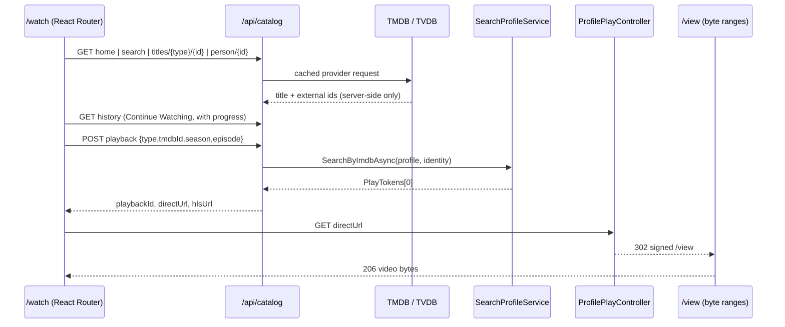

# Watch catalog

Status: implemented
Date: 2026-10-28

The `/watch` catalog turns a TMDB/TVDB browse experience into InfiniDysk playback
without a second Usenet engine. Metadata is provider-only; every play action resolves
to the existing search → verify → mount → `/view` byte-range pipeline.

This page documents the implementation for maintainers. Operational steps for a
localhost install are in [Running it locally](#running-it-locally); the reasoning
behind the playback decisions is in
[ADR 0003](../decisions/0003-watch-catalog-playback.md).

## Request flow



The browser never receives external IDs, profile tokens, NZB URLs, or signed view
URLs it did not just receive from a play response.

## Configuration

All three settings are headless (`NZBDAV_CONFIG__…`), masked in config responses, and
redacted from support packs.

| Key | Environment variable | Purpose |
|---|---|---|
| `metadata.tmdb-read-token` | `NZBDAV_CONFIG__METADATA__TMDB_READ_TOKEN` | TMDB bearer token. Absent → catalog returns 503 `Catalog metadata is not configured.` |
| `metadata.tvdb-api-key` | `NZBDAV_CONFIG__METADATA__TVDB_API_KEY` | TVDB login key for episode data. Absent → series episodes fall back to TMDB. |
| `catalog.profile-token` | `NZBDAV_CONFIG__CATALOG__PROFILE_TOKEN` | Token of the search profile the catalog plays through. Absent → 503 `Catalog playback is not configured.` |

The profile itself must exist, be enabled for the JSON adapter, and include the
indexer used for catalog searches. The catalog never accepts a profile token,
indexer name, or source URL from the browser; it reads the configured token.

Recommended profile ordering is `Web1080p`, which prefers 1080p H.264, then non-REMUX
releases, smallest first. `Off`, `Resolution`, and `ResolutionAndSource` keep their
previous ordering exactly.

## API surface

All routes require authentication and answer with the legacy `BaseApiResponse`
envelope (`status`, `error`) or the shared problem-details filter for admin routes.

| Method | Route | Notes |
|---|---|---|
| GET | `/api/catalog/home` | Eight provider rows fetched concurrently: `trending`, `popular-movies`, `popular-series`, `top-rated-movies`, `now-playing`, `upcoming-movies`, `top-rated-series`, `trending-people`. Cache 15 min. Continue Watching is not a provider row and is served by `/api/catalog/history`. |
| GET | `/api/catalog/search?q=&page=` | 1–100 character query, page 1–20. People results dropped. Cache 5 min. |
| GET | `/api/catalog/titles/{type}/{tmdbId}?season=` | `movie` or `series`. Seasons/episodes included. Cache 24 h. |
| GET | `/api/catalog/person/{personId}` | Biography header plus one merged, popularity-ordered credit list. Cache 24 h. |
| GET | `/api/catalog/history?limit=` | Resume rows, resumable first, finished at the tail. Default 20, capped at 200. Never cached. |
| POST | `/api/catalog/history/progress` | `{type, tmdbId, season?, episode?, position, duration?, finished?}` → `{status}`. Display fields are resolved server-side. |
| DELETE | `/api/catalog/history/{id}` | Removes one row: "Remove from Continue Watching". 404 when the row is already gone. |
| POST | `/api/catalog/playback` | `{type, tmdbId, season?, episode?}` → `{playbackId, directUrl, hlsUrl, releaseTitle}`. |
| GET | `/api/catalog/playback/{id}/playlist.m3u8` | Authenticated VOD manifest. |
| GET | `/api/catalog/playback/{id}/segments/{index}.ts` | `video/mp2t`, generated on demand. |

Home rows carry exactly one of `items` (title cards) and `people` (the
`trending-people` row), never both, and the strict row schema rejects a row with
neither. Continue Watching comes from its own endpoint, which carries the resume
coordinates and progress a bare summary row cannot express.

Status codes are meaningful: `400` invalid coordinates, `404` unknown title, empty
release list, or expired session, `422` missing external identity or unusable duration,
`502` provider/encoder failure, `503` unconfigured or still preparing (with
`Retry-After`).

### Watch history

`catalog_watch_history` holds one resumable row per title (per episode for series). The
unique index is filtered to `NOT "Finished"`, so re-watching a completed title starts a
new row instead of colliding with history. The row is written twice:

1. When playback resolves a stream, with the server-resolved title, episode label,
   artwork, and position 0 — so Continue Watching is accurate even if the player never
   reports.
2. Every 10 s from the player (one report per six-second segment boundary) and once on
   `ended`, which flips `Finished` and pins the position to the duration.

Starting a title again supersedes its finished row, so the row never shows a stale
"Watched" card beside the live one; rows older than 32 days are pruned on the next
write. History failures stay local: a failed write never costs the viewer a working
stream, and a failed read empties only the Continue Watching row — the catalog rows come
from the provider cache and are unaffected.

### Identity mapping

- Movie → IMDb `tt…`; missing IMDb is `422`.
- Series → `tvdb:{tvdbId}:{season}:{episode}` when TVDB is mapped, else
  `{imdbId}:{season}:{episode}`; neither is `422`.

## Playback modes

The player starts in **HLS compatibility mode** whenever the play response includes an
`hlsUrl`, because Firefox cannot play the common Matroska/AC-3 combination and direct
seeks on remote containers are slow. `direct` remains an explicit choice in the player
and the automatic fallback when the browser reports no HLS support at all.

| Mode | Source | When |
|---|---|---|
| `direct` | `directUrl` → 302 → `/view` | Old browsers, explicit selection, no MSE |
| `hls` | `hlsUrl` → manifest → `segments/N.ts` | Default for catalog playback |

Mode switching preserves position. Only HLS → direct happens automatically, and only
when HLS is structurally unavailable (`canPlayType` empty and `Hls.isSupported()`
false, or the lazy import fails). A direct-source rejection never bounces back.

Transient HLS failures (network, decode, segment abort) enter bounded recovery with a
resume position instead of becoming terminal. `unsupported` is reserved for
structurally impossible playback.

## Compatibility encoder

The HLS path is one long-running FFmpeg process per session:

1. Resolve the internal `/view` URI once (redirect must be rooted and `/view/…`;
   anything else is rejected as SSRF).
2. Probe duration once with `ffprobe`.
3. Start a run that encodes the requested span as an HLS *event* playlist with forced
   six-second keyframes and `-output_ts_offset` on the absolute timeline.
4. Publish each segment as soon as its file stabilizes; the request waits on the run
   and streams the completed file.

Why one process: independent per-segment encodes each re-prime the AAC encoder and
rebase timestamps, which inserts a one-packet audio hole and a decoder re-init at every
boundary — audible as a 4–6 s microstutter. A continuous encode keeps one timeline:
audio meets video exactly at each cut, and no discontinuity tags are needed.

Seeking starts a new run at the target boundary. Both runs use the same absolute
timeline, so their segments splice; a tiny overlap at the very first frame of a new run
is accepted by both native HLS and hls.js.

| Concern | Behavior |
|---|---|
| Encoder priority | `nice -n 10` so playback wins CPU during buffer fill |
| Slow segments | Warning logged with index and elapsed ms |
| Concurrency | One run per session/index; waiters share the result |
| Cache | 2 GiB bound, LRU, open readers and awaited segments pinned |
| Eviction | Never the segment being read, awaited, or just produced |
| Cleanup | Five-minute sweep removes expired sessions and stale temp files |

## Player UX

`PlayerOverlay` is a full-screen OSD layered over the video: auto-hiding chrome,
buffered/played seek rail, ±10/30 s, volume, speed menu, PiP, fullscreen, failure
banner, and a playback-data panel (`i`).

Series playback carries the season's episode order with the target, so the player adds
previous/next episode buttons beside the transport (disabled at the season edges) and
autoplays the next episode when the current one ends. The switch is a new playback
session: the finished episode's history row is written first, then the dialog resolves
the next episode's stream and mounts a fresh player, which autoplays. At a season finale
the player fetches the next season's episode list and continues with its first episode;
only the last episode of the last season stops. Stepping backwards stays within the
loaded season.

Chrome is text-shadow only — no translucent fills or backdrop blur. Measured on this
host, painting translucent bands over 1080p video cost 9–11 dropped frames per 20 s;
identical chrome with fills removed dropped 0.

The pointer is part of the chrome: `cursor-none` is applied to the player shell whenever
the chrome is hidden, so the cursor disappears after the idle delay — in fullscreen
too — and returns on pointer movement.

Keyboard: space/k play, arrows/j/l seek, up/down volume, m mute, f fullscreen, 0–9
jump, i playback data, `[` / `]` previous/next episode, Escape dismisses menu → exits
fullscreen → closes.

## Running it locally

```bash
./scripts/start-watch.sh          # builds, starts, waits for /healthz, prints the URL
```

The script sources `${NEWSDEMON_ENV:-$HOME/Documents/newsdemon.env}` and `.env.watch`,
requires a readable credential file and non-empty expected keys without printing them,
generates `WATCH_PROFILE_TOKEN` into `.env.watch` on first run, and never writes
credential values into `compose.yml`.

Deployment is localhost-only: `127.0.0.1:3000:3000`, account authentication enabled,
`SECURE_COOKIES=false` for HTTP. `config/` and `transcode-cache/` are gitignored.

## Diagnostics

Press `i` while playing and read the panel:

| Symptom | Reading |
|---|---|
| `Frames` climbing | Client decode/compositing — look at the OSD, GPU, or resolution |
| `Stalls` climbing, buffer near zero | Production/network cannot keep up |
| Boundary-periodic hitch only with chrome visible | OSD compositing cost |
| `Catalog compatibility segment … took … ms` | Encoder slower than the segment duration |

Health checks used during development: concatenate consecutive segments and confirm
zero DTS regressions for both streams, confirm audio RMS is flat across a boundary
(a dip means a hole), then confirm live playback reports `droppedVideoFrames = 0`.

## File map

| Area | Path |
|---|---|
| Metadata clients | `backend/Clients/Metadata/{MetadataHttp,TmdbClient,TvdbClient}.cs` |
| Catalog service and models | `backend/Services/Catalog/CatalogService.cs`, `backend/Models/Catalog/Models.cs` |
| Playback identity/session | `backend/Services/Catalog/{CatalogPlaybackService,CatalogPlaybackSessionStore,CatalogBackendUrl}.cs` |
| Watch history | `backend/Services/Catalog/CatalogWatchHistoryService.cs`, `backend/Database/Models/CatalogWatchHistory.cs` |
| Encoder | `backend/Services/Catalog/{FFmpegRunner,CatalogTranscodeRun,CatalogTranscodeService,CatalogHlsManifest}.cs` |
| API | `backend/Api/Controllers/Catalog/` |
| Shared player | `frontend/app/components/media-player/` |
| Catalog UI | `frontend/app/components/watch/`, `frontend/app/routes/watch*` |
| Contracts | `contracts/admin/v1/catalog-*.schema.json` |

## Known limits

- One encoder at a time is not enforced globally; runs are bounded by lookahead (8
  segments) and the cache bound instead.
- Segment cuts follow FFmpeg's keyframe grid, so a run's first video frame can be a few
  milliseconds off the nominal boundary.
- TVDB episode pagination caps at 20 pages before answering 502.
- Sessions are in memory: restarting the backend requires clicking Play again.
